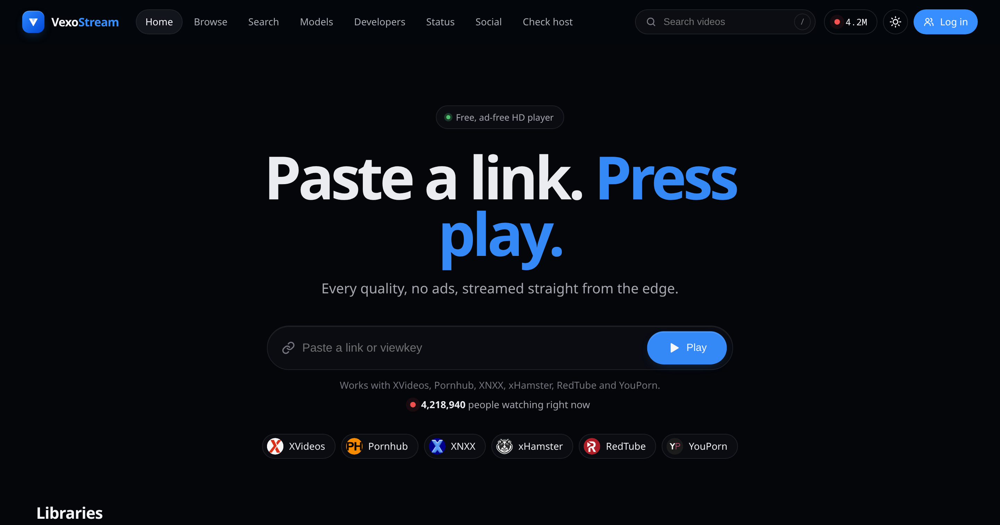
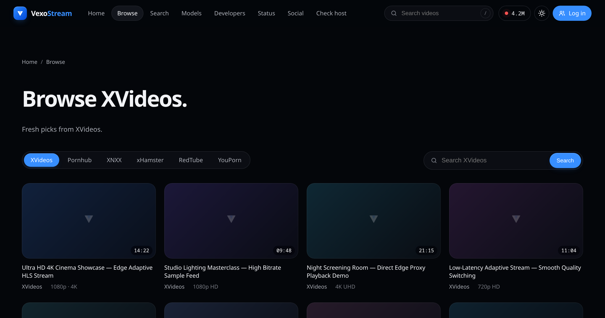
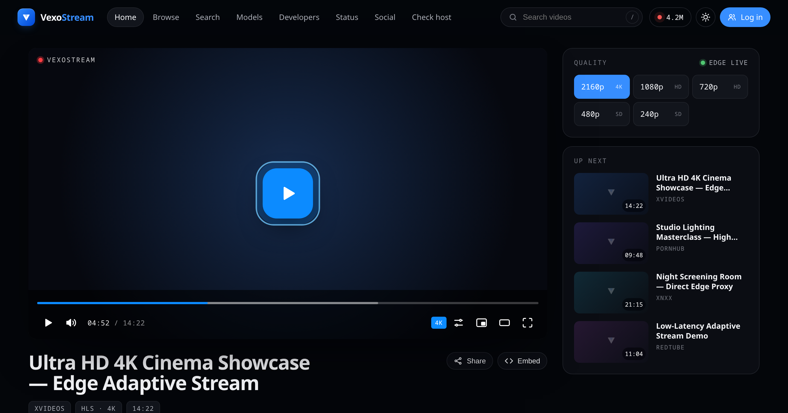
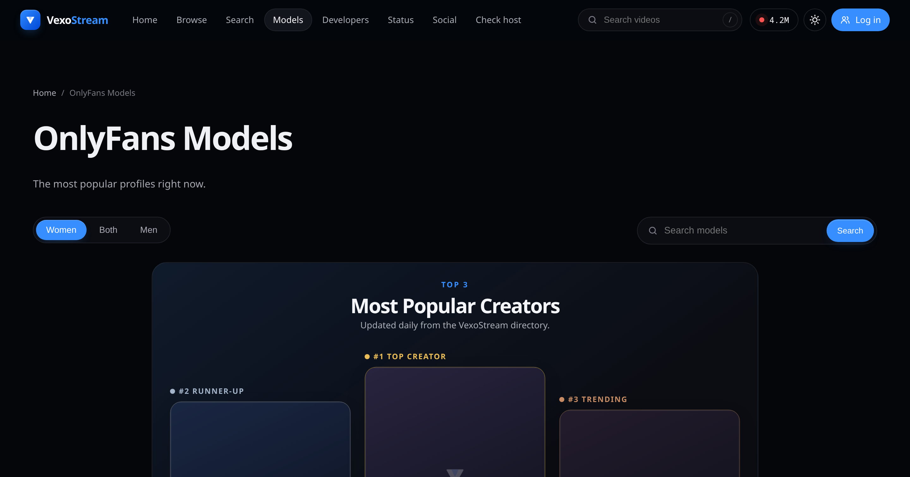
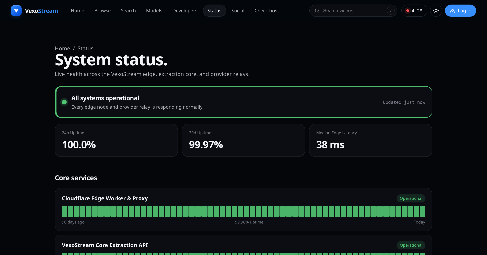
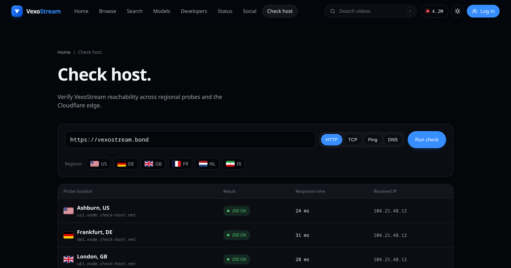
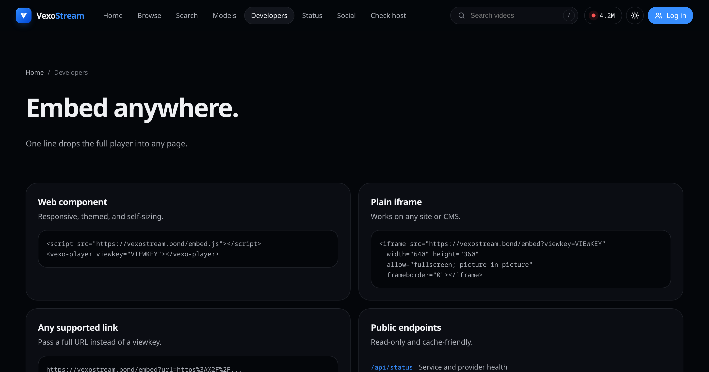
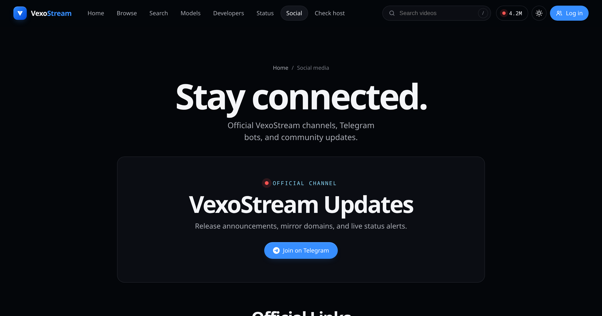
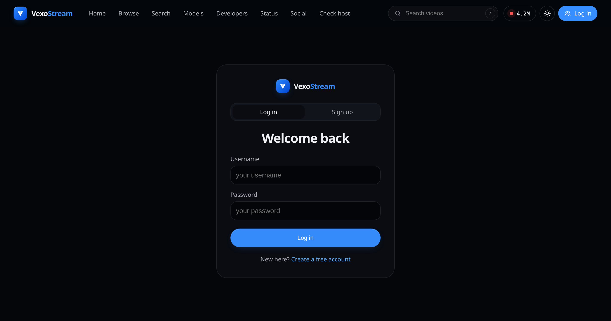
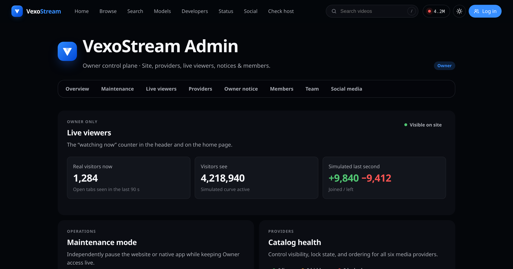

<p align="center">
  <picture>
    <source media="(prefers-color-scheme: dark)" srcset="site/assets/brand/vexostream-logo-dark.png">
    <source media="(prefers-color-scheme: light)" srcset="site/assets/brand/vexostream-logo.png">
    
  </picture>
</p>

<p align="center">
  <strong>Every quality. No ads. Straight from the edge.</strong><br>
  Cloudflare Worker streaming site &amp; API (<code>site/</code>), Core extractor (<code>core/</code>), and Flutter Windows/Android client (<code>apps/flutterapp/</code>).
</p>

---

## Site Screenshots

| Home (`/`) | Browse &amp; Search (`/browse`, `/search`) |
| :---: | :---: |
|  |  |

| Video Player (`/video`, `/embed`) | OnlyFans Models (`/models`) |
| :---: | :---: |
|  |  |

| System Status (`/status`) | Check Host (`/check-host`) |
| :---: | :---: |
|  |  |

| Developers &amp; Embed (`/developers`) | Social Media (`/social`) |
| :---: | :---: |
|  |  |

| Member Login &amp; Sign Up (`/login`, `/signup`) | Admin Control Plane (`/adminpanel`) |
| :---: | :---: |
|  |  |

---

## Highlights

- **Universal browser styling (`site/`)**: All CSS tokens and inline styles use standard sRGB HEX / `rgba()` colors instead of `oklch()` or `color-mix()`, and `site/scripts/build.mjs` automatically lowers Tailwind v4 output (unwrapping `@layer`, replacing `@property` with universal `--tw-*` defaults, stripping `:where()`, and adding `100vh`, `overflow-x: hidden`, and physical `inset` fallbacks) so every page loads cleanly even in rare, legacy, or lightweight WebView browsers.
- **Consistent VexoStream branding**: The official VexoStream mark and wordmark render cleanly across the top navigation bar, mobile drawer, footer, age gate, member auth card, and admin login/dashboard with explicit SVG dimensions.
- **Bundled offline fonts in the app (`apps/flutterapp/`)**: Geist and Geist Mono (site UI), Vazirmatn (Persian), and Noto Sans Arabic (Arabic fallback). Nothing is downloaded at runtime.
- **Smart quality picker**: Shows main qualities only; fallback sources stay hidden and activate automatically if a primary source fails.
- **Automated releases (`.github/workflows/build.yml`)**: Tests the website and app, builds the Windows installer/portable ZIP and universal Android APK, and publishes version-tagged GitHub Releases.

## Repository layout

```text
.
├── site/                   Cloudflare Worker site + API v1 source
│   ├── src/                Pages, routing, account logic, universal CSS
│   ├── assets/             Brand logos, flags, fonts, social & provider icons
│   ├── migrations/         Idempotent D1 migrations
│   ├── scripts/            Worker build (with universal CSS lowering) and tests
│   └── wrangler.toml       Cloudflare routes and D1 bindings
├── core/                   VexoStream Core extraction/catalog API
├── apps/
│   └── flutterapp/         Flutter Windows and Android app source
├── docs/
│   └── screenshots/        Captured previews of all site pages
├── .github/workflows/      GitHub Actions tests, builds and releases
├── README.md
└── SECURITY.md
```

## What is included

### Site

The VexoStream v25 Worker source is under `site/`, including its pages, provider settings, member sign-in, admin panel, status, social page, developers page, Check host, and media proxy. The site and app API are built together into one Cloudflare Worker.

### Core API

`core/` contains the FastAPI extraction/catalog service used by the Worker. Deploy it as a separate service, then set the Worker's `RAILWAY_URL` or `BACKEND_URL` and matching `EDGE_TOKEN`. Playback extraction URLs are intentionally never cached because provider CDN links expire; both Core extraction routes return `Cache-Control: no-store`.

### Windows &amp; Android app

`apps/flutterapp/` contains the Flutter client and all app code. It includes an 18+ first-run confirmation, Home, Browse/Search, performer directory and profiles, VexoStream embedded video playback with quality selection, “More like this,” the player shortcut reference, share/embed snippets, device-local Continue Watching with resume, account sign-in/sign-up, Status, Social, Developers/embed, and Check host pages. Bearer tokens are stored securely on supported platforms; account sessions can be revoked by signing out.

GitHub Actions tests the site and Flutter source, builds Windows and Android, and packages the NSIS installer. It uploads the installer separately and in a bundle with the portable Windows ZIP. When `APP_KEY` is missing, artifacts are explicitly marked validation-only because protected API calls will not work. Site Owner and delegated Admin credentials work in the app login form. Both bypass maintenance while signed in, and the Admin dashboard exposes only the controls their server-side permissions allow. Live viewer settings remain Owner-only.

The app Check Host page shows regional probes and the Cloudflare edge separately, including progress, errors and response details. It uses the same authorized-host and port restrictions as the website. Windows uses Edge WebView2; Android uses Android System WebView, whose native error pages can differ. The app uses the allowlisted first-party VexoStream embedded player as its only playback surface.

### API

Base URL: `https://api.vexostream.bond/api/v1`

| Method | Endpoint | Purpose |
| --- | --- | --- |
| GET | `/health` | Worker/API health |
| GET | `/config` or `/providers` | Provider list, default provider, account policy |
| GET | `/catalog?provider=xvideos&q=trending&page=1` | Browse/search catalog |
| GET | `/search?q=...&provider=...&page=1` | Search alias |
| GET | `/models?gender=women&search=...&page=1` | Performer directory |
| GET | `/models/{slug}` | Performer profile |
| GET | `/image?url=...` | Proxied thumbnails, posters, and performer photos |
| GET | `/posters?u=...` | Real video posters (og:image), up to 24 per call |
| GET | `/status` | System and provider status |
| GET | `/social` | Public social links and bots |
| GET | `/developers` | Embed snippet and endpoint reference |
| GET | `/check-host/nodes` | Available diagnostic nodes |
| GET | `/check-host/start?host=...&type=http` | Start an authorized host check |
| GET | `/check-host/result?id=...&type=http` | Poll a host check |
| POST | `/auth/signup` | Create account, requires `username`, `password`, `passwordConfirm`, and `adult: true` |
| POST | `/auth/login` | Create a member bearer session |
| POST | `/auth/logout` | Revoke the current bearer session |
| GET | `/account` | Read the signed-in account |
| POST | `/embed/grant` | Create a five-minute, video-bound grant for the signed-in app’s WebView |
| POST | `/videos/extract` | Resolve a supported video URL into Worker-proxied streams |

Successful signup/login returns a 30-day bearer token. Send it as `Authorization: Bearer <token>` for protected endpoints. Only a SHA-256 hash is stored in D1. Passwords reuse the site's PBKDF2-SHA256 account handling. `EDGE_TOKEN` is never sent to the app.

The API uses the existing site's policies: provider locks/hidden states are enforced, performer access follows the member setting, and stream extraction follows the login-to-watch setting. Check host is intentionally limited to VexoStream-owned hosts and explicitly authorized targets. It is not an unrestricted scanner.

## Important backend dependency

The site forwards catalog, model, poster, and stream-extraction requests to VexoStream Core using the Worker `RAILWAY_URL`/`BACKEND_URL` setting and `EDGE_TOKEN`. The Core source is included in `core/`, but it still runs and deploys separately from the Cloudflare Worker. If Core is unavailable or the URL/token pair is wrong, the app shell and account pages can load while browsing and playback fail.

## Push to GitHub

1. Create an empty GitHub repository.
2. Unzip this repository locally.
3. Initialize Git, commit, and push the root contents. Example:

   ```bash
   git init
   git add .
   git commit -m "Fix universal site styles, add logo and page screenshots"
   git branch -M main
   git remote add origin https://github.com/OWNER/REPOSITORY.git
   git push -u origin main
   ```

4. Configure the optional repository secret `APP_KEY` to build API-ready artifacts. After a successful push to `main` or `master`, GitHub Actions automatically creates the `v<version>` tag from `apps/flutterapp/pubspec.yaml`, creates a GitHub Release, and uploads the Windows installer, portable ZIP, and universal Android APK if that version has not already been released. Later pushes without a version bump still run CI but skip publishing, so existing releases are never overwritten. Bump the app version for each new release; pull requests do not publish releases. You can also push a matching version tag manually. Without `APP_KEY`, artifacts are labeled validation-only and the Release is a pre-release.

## Configure Cloudflare before deployment

The `site/wrangler.toml` carries forward the zone and D1 IDs from the supplied archive. Confirm they belong to the Cloudflare account you intend to deploy to; replace the D1 IDs if you created different databases. Ensure the zone `vexostream.bond` is active in that account.

Set Worker secrets in Cloudflare before deploying:

- `STREAM_SIGN_SECRET`: a long, random secret used for signed sessions and media URLs.
- `EDGE_TOKEN`: a separate long, random token shared with the configured VexoStream Core backend.
- `APP_KEY`: a random app-access key. The Worker requires it in `X-App-Key` for every `/api/v1` request. Stream proxy URLs use their own short-lived signatures.
- `TELEGRAM_BOT_TOKEN`: optional, only if the Telegram bot is enabled.
- `ADMIN_USERS`: optional legacy bootstrap admins, if used.

Set `APP_KEY` only as a Cloudflare Worker secret with `npx wrangler secret put APP_KEY` from `site/`. Site deployment remains manual; GitHub Actions never deploys the Worker. To build API-ready app artifacts, add the same value as the repository **secret** `APP_KEY`.

Set the Worker `RAILWAY_URL` (or `BACKEND_URL`) to the public HTTPS origin for the VexoStream Core service. Do not put `EDGE_TOKEN` in Flutter or in the repository. If using the admin panel's backend override, that saved value takes precedence over the Worker variable.

The Worker serves these Cloudflare zone routes:

- `vexostream.bond/*`
- `www.vexostream.bond/*`
- `api.vexostream.bond/*` for the API and media proxy

## Deploy site and API manually from Windows CMD

Rebuild the Worker after style edits so `dist/worker.js` picks up the universal CSS lowering pass, then deploy:

```bat
cd /d C:\path\to\VexoStreamOfficial-main\site
npm install && npm run build && npx wrangler deploy
```

Before first app use, apply the idempotent D1 migrations from `site/`:

```bat
npx wrangler d1 execute DB --file=./migrations/2026-11-11-api-sessions.sql --remote && npx wrangler d1 execute DB --file=./migrations/2026-11-12-admin-api-sessions.sql --remote
```

## Local source checks

```bash
cd site && npm install && npm test
cd ../core && python deploy/tests/test_stream_freshness.py
cd ../apps/flutterapp && flutter pub get && flutter test
```

## App design

The app uses the site's v25 dark "night-screening room" tokens (ink surfaces, signal blue `#378EFF`, pill controls, 18px rounded surfaces, hairline rings), the Geist and Geist Mono fonts, the VexoStream logo and mark, and the same layout ideas: top bar with search, sidebar/drawer navigation, the "Paste a link. Press play." hero, video cards, Continue Watching, player recommendations and shortcuts, and site-style empty/error states. The Windows build workflow sets the VexoStream icon, window title, and `VexoStream.exe` name. A newer stable GitHub Release blocks app use until the platform-specific update is opened; failed checks are shown as unverified and can be retried.
